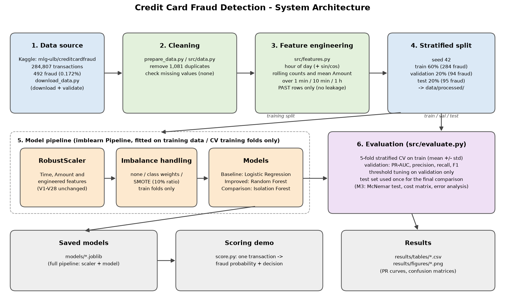
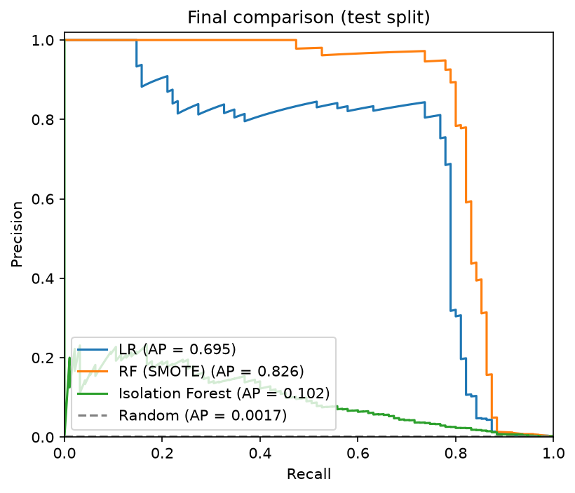

# Credit Card Fraud Detection under Extreme Class Imbalance

CS5998 Capstone Project - Perera A A L N - (268476J)

## Overview

Only 0.172% of the transactions in the dataset are fraud, so a model that always predicts
"not fraud" gets about 99.8% accuracy and catches nothing. This project builds a reproducible
pipeline that treats fraud detection as both a classification and an outlier-detection
problem, and judges models by precision, recall, F1 and PR-AUC instead of accuracy.

- **Baseline:** Logistic Regression
- **Improved:** Random Forest with class weights, SMOTE and decision-threshold tuning
- **Comparison:** Isolation Forest (unsupervised outlier detection)

## Dataset

[Credit Card Fraud Detection](https://www.kaggle.com/datasets/mlg-ulb/creditcardfraud)
(ULB Machine Learning Group, Kaggle): 284,807 transactions, 492 fraud. The raw data is not
stored in this repository.

To get the data, either log in to Kaggle once with `kaggle auth login`, or download
`creditcard.csv` by hand into `data/raw/`. Then run:

```
python scripts/download_data.py
```

The script downloads the file if it is missing and checks its rows, columns and fraud count.

## System architecture



Regenerate with `python scripts/make_architecture_diagram.py`.

## How to run

Tested on Windows 11, Python 3.14.2, Intel Core Ultra 5 125H, 32 GB RAM, CPU only (no GPU).
All random seeds are fixed to 42 in `src/config.py`.

```
python -m venv .venv
.venv\Scripts\activate            # Linux/macOS: source .venv/bin/activate
pip install -r requirements.txt
```

Run the steps in this order:

| Step | Command | What it does | Time* |
|---|---|---|---|
| 1 | `python scripts/download_data.py` | download and validate the dataset | < 1 min |
| 2 | `python scripts/prepare_data.py` | remove duplicates, add features, stratified 60/20/20 split | < 1 min |
| 3 | `notebooks/01_eda.ipynb` | exploratory data analysis (training split only) | < 1 min |
| 4 | `python scripts/train_baseline.py` | Logistic Regression, with and without class weights | < 1 min |
| 5 | `python scripts/train_random_forest.py` | Random Forest: no balancing, class weights, SMOTE | ~13 min |
| 6 | `python scripts/train_isolation_forest.py` | Isolation Forest (unsupervised) | < 1 min |
| 7 | `python scripts/tune_threshold.py` | choose thresholds on validation, final test evaluation | < 1 min |
| 8 | `python scripts/score.py --sample fraud --n 5` | scoring demo | seconds |

\*on the hardware above. Tables are saved to `results/tables/`, figures to `results/figures/`.

## Method summary

- **Cleaning:** 1,081 exact duplicate rows removed before splitting (19 of them fraud).
- **Features:** hour of day (with sin/cos encoding) and rolling transaction counts and
  mean amounts over the previous 1 min / 10 min / 1 h. Rolling windows use past rows only.
- **Split:** stratified 60/20/20 train/validation/test (284 / 94 / 95 fraud).
- **Scaling:** RobustScaler on Time, Amount and engineered features, inside the model pipeline.
- **Imbalance:** class weights or SMOTE (fraud up to 10% of the normal class). SMOTE is a
  pipeline step, so it only sees training folds.
- **Evaluation:** 5-fold stratified CV on the training split, PR-AUC, precision, recall, F1.
  Thresholds are chosen on validation; the test split is used once for the final numbers.

## Results so far

Test split (95 fraud, 56,746 transactions), thresholds fixed on validation:

| Model | PR-AUC | Precision | Recall | F1 | Fraud caught | False alarms |
|---|---|---|---|---|---|---|
| Logistic Regression (0.5) | 0.695 | 0.833 | 0.579 | 0.683 | 55 / 95 | 11 |
| Logistic Regression (best-F1 threshold) | 0.695 | 0.842 | 0.726 | 0.780 | 69 / 95 | 13 |
| **Random Forest + SMOTE (0.5)** | **0.826** | 0.947 | **0.758** | **0.842** | 72 / 95 | 4 |
| Isolation Forest (no labels) | 0.102 | 0.191 | 0.179 | 0.185 | 17 / 95 | 72 |

Random guessing gives PR-AUC 0.0017. Full tables are in `results/tables/`.



Main points so far:

- Random Forest with SMOTE is clearly better than the Logistic Regression baseline (H1).
- Class weights move the threshold but do not improve the ranking (PR-AUC); for LR they raise
  recall to 0.90 but cause 1,536 false alarms on validation (H2 is only partly supported).
- Isolation Forest finds some fraud without labels but is far behind the supervised models (H3).
- Thresholds tuned on the 94 validation frauds did not transfer well to the test set, so recall
  on test (0.71-0.76) is below the 0.80 target.

## Next steps (Milestone 3)

- McNemar's test for the LR vs RF difference
- Ablation: with/without engineered features, and none / class weights / SMOTE
- Thresholds from cross-validated predictions and an explicit cost matrix
- Feature importance and error analysis of missed fraud
- Final report and reproducibility checklist

## Repository structure

```
data/            raw and processed data (not tracked by git)
docs/            architecture diagram
notebooks/       exploratory analysis
src/             pipeline code (config, data, features, models, evaluation)
scripts/         command-line entry points (run in the order above)
results/         generated tables and figures
models/          trained models (not tracked, created by the training scripts)
report/          milestone reports
```
